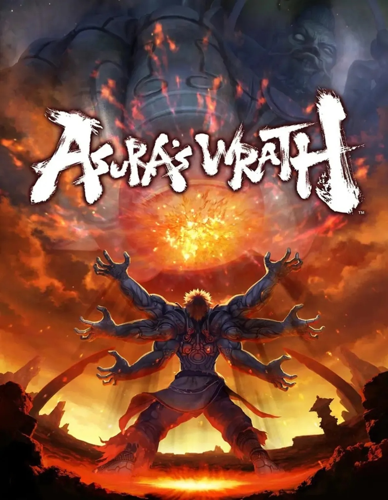

# Asura's Wrath — Native Windows x64 Progress Portal (`BLUS30721`)

[-yellow.svg)](PROGRESS.md)

  

> **[Milestone Log & Fix History](PROGRESS.md)** | **[Open Issues & Visual Findings](docs/KNOWN_ISSUES.md)** | **[Controls & Input Mapping](docs/INPUT_MAPPING.md)**  
> Compatibility tracking and technical progress portal for the native static recompilation of **Asura's Wrath** (`BLUS30721`, PlayStation 3, Unreal Engine 3) running on **Windows 10/11 x64 + Direct3D 12**.  
> **Important:** This is an active **work-in-progress (`WIP`) documentation portal**. **No source code, patches, prebuilt `.exe` binaries, PS3 dumps, decryption keys, or copyrighted assets are distributed here.**

---

## 1. Project Overview & Architecture (Without Source Code)

Unlike a PS4 x86-64 wrapper, PlayStation 3 titles run on a heterogeneous **Cell Broadband Engine** (64-bit PowerPC **PPU** + **SPU** vector cores) paired with an **RSX** GPU. This research port translates decrypted game binaries ahead of time into native Windows x64 execution on top of `ps3recomp`:

| Subsystem | Verified Port Scope |
| :--- | :--- |
| **Title / Build Target** | *Asura's Wrath* — US Base `BLUS30721` (`APP_VER=01.00`, decrypted `EBOOT.ELF` `27.1 MB`) |
| **Static Recompilation Scale** | **`30,350`** PPU functions + **`27`** extracted SPU ELF images (`1.52 MB`) + **`6`** embedded SPURS `Job2` modules (`ShaderPatching`, `WriteFence`, `Job3`, `PhysX1`, `Fluid1`, `Fluid2`) + **`2`** multistream audio/overlay modules |
| **Graphics Backend** | **Direct3D 12** (`rsx_d3d12_backend`, native `1280x720`) with persistent `rsx_shader_cache_v2` (`0` shader rejects after warm-up) and `NV0039` 2D-to-3D `subch 1` DMA routing |
| **Video & Audio** | Uses **internal Unreal Engine 3 Bink Video** (`0` imports to `cellVdec` / `cellPamf` / `cellDmux` / `cellAdec`) + host audio output |
| **Input Backend** | **Windows XInput** (`XInput1_4` / `XInput1_3` / `XInput9_1_0`, ports `0..3`) + **Win32 `GetAsyncKeyState` Keyboard fallback** (Port 0 when window focused; **does not use SDL3 or SDL2**) |
| **Development Executable** | Local static dev build `AsurasWrathRecomp.exe` (`~403.7 MB` / `423,291,392` bytes, verified `0` SPU dispatch misses) — **not yet released publicly** |

---

## 2. Current Progress Scorecard ("Baru Sampai Mana?")

The port has completed **Tier 0**, **Tier 1**, and **Tier 2** milestones (boot through playable Episode 1), while full-campaign completion, visual parity polish, and public binary packaging remain work in progress:

| Milestone / Case | Target Description | Status | Measured Results |
| :--- | :--- | :--- | :--- |
| **Tier 0 (`TC-01`, `TC-02`)** | No-dump safety guard + full boot through Capcom / CyberConnect2 / UE3 / SpeedTree logos with `SPU_MISS_FATAL=1` | **PASS** | Boots to Title Screen (`40.2s` / `43.2s`), post-logo black screen resolved via SPURS `Job2` lifting (`0` SPU dispatch miss) |
| **Tier 1 (`TC-03`, `TC-05`)** | Title video (`TITLEMENU_BG00.BIK`), Main Menu navigation, `cellSaveData` AutoSave & AutoLoad | **PASS** | Saves `81,920`-byte `PAYLOAD` (`BLUS30721-BCSAVEDATA`), reloads `"Load successful."`, unlocks `EPISODE MENU` entry |
| **Tier 2 (`TC-04`)** | Episode 1 (`BC-S000`) playable: orbital combat, skeletal 3D meshes (`CMP` `T6x1`), QTE `L↓ + R↓`, post-QTE cloud/water scenes, Earth-orbit rail-shooter | **PASS** | QTE `L↓ + R↓` cleared with real physical input; average **`35.43 – 39.77 FPS`** (`+4.39 FPS` vs before `CMP` fix), `0` hang/abort |
| **Deterministic Build (`TC-08`)** | Full PPU + SPU + SPURS relift reproducibility & Windows CTest suite | **PASS** | 2 consecutive full relifts produced **`251` identical files** (`0` mismatches); Windows runtime unit suite **`30/30` passed** |
| **`TC-06` (30-Min Soak Test)** | Continuous 30-minute (`1800s`) stability & memory profile test | **PARTIAL (`330.11s`)** | Longest continuous strict run reached **`330.11s` (~5.5 min, `660` frames)** with zero crash/leak; full `1800s` soak pending |
| **Ep. 1 Armada Visuals & `TC-07`** | Earth-orbit armada ships & Gohma visual parity vs RPCS3 `BLUS30721` golden frames | **IN PROGRESS (Open)** | Occlusion query fix restored `129–208` culled draws, **but** armada/Gohma particle & shader lighting parity on `vs=37` and `P1-V1..V3` remain under investigation |
| **Episodes 2, 3 & Full Campaign** | Playable progression beyond Episode 1 (`BC-S010`, `BC-S020`, `Update v1.02`) | **NOT YET TESTED / LOCKED** | Save `PAYLOAD` shows `Ep 1` `ClearFlg=2` (*in progress*), `Ep 2 & Ep 3` locked (`ClearFlg=0`) until Ep. 1 boss clear save; `Update v1.02.pkg` not merged yet |
| **Public Portable Release** | Standalone end-user Windows release binary + GUI launcher | **NOT AVAILABLE YET** | Dev binary (`403.7 MB`) statically embeds lifted game code; awaits campaign/visual stability and clean launcher workflow |

---

## 3. Summary of What Works vs What Remains Open

### Already Working
- **Clean Boot & Strict SPU / SPURS Scheduling:** Eliminated post-UE3/SpeedTree logo hangs by extracting and registering all `6` embedded SPURS `Job2` modules plus `2` multistream overlays cleanly under `SPU_MISS_FATAL=1`.
- **3D Character & Skeletal Geometry Reconstruction (`CMP` `T6x1`):** Fixed PS3 `CELL_GCM_VERTEX_CMP` (`11-11-10`, `size=1`) coordinate truncation where vertex `Y/Z` collapsed to `0`—restoring full 3D rigged meshes (Asura, tentacles, wings, QTE models) and boosting Episode 1 render speed from `31.04 FPS` to `35.43 FPS`.
- **Title Screen, Save/Load & Episode 1 Gameplay:** `TITLEMENU_BG00.BIK` playback, `NEW GAME` flow, `cellSaveData` round-trips, orbital rapid-fire combat, `L↓ + R↓` atmospheric re-entry QTE, cloud/water transitions, and rail-shooter progression all execute without crashes or SPU misses.

### Still Open (Current Bottlenecks)
1. **Episode 1 Earth-Orbit Armada / Gohma Material & Particles (`vs=37`):** Fixing `NV4097_GET_REPORT` Local VRAM writes stopped UE3 from culling 129–208 invisible ship/Gohma draws, and stride-0 attribute fetches were audited, **but** visual captures on `t025s/t040s/t055s` still show overly bright surfaces / dense red billboard particles. Telemetry confirmed vertex attribute `a4=(1,1,1,1)` already reaches `vs=37`, so fragment-shader & texture-binding correlation on stabilized orbit scenes is the next diagnostic step.
2. **Secondary Visual Candidates (`P1-V1` – `P1-V3`):** Awaiting RPCS3 `BLUS30721` 720p golden frames (`TC-07`) to tune water surface refraction offset (`Gohma Carrier`), verify top-right QTE additive cones (`P1-V2`), resolve the 1–2 px black left border strip from quarter-res `322x182` downsampling guard-band (`P1-V3`), and clean a minor Auto-Load dialog bottom-edge blend artifact.
3. **Full Story & Update `v1.02`:** Playthrough to Episode 1 Boss Clear Save (`ClearFlg=1`) is needed to unlock Episode 2/3 testing, alongside extracting/merging `Update v1.02.pkg` (currently targeting Base `v01.00`) and running the 30-minute soak test (`TC-06`).

---

## 4. Controls Overview (Windows XInput & Keyboard)

> **Critical Note:** Keyboard input on this port uses **Arrow Keys + `I/J/K/L`**, **NOT WASD** (`S` = Triangle, `W` = R1, `A` = Square)! Keyboard only activates on Port 0 when **no XInput controller** is plugged in and the game window has focus.

| PS3 Action | Xbox / XInput | Keyboard (Port 0) |
| :--- | :--- | :--- |
| **Movement / Left Stick + D-Pad** | `Left Stick` / `D-Pad` | `Arrow Keys` (`Up/Down/Left/Right`) |
| **Camera / Right Stick** | `Right Stick` | `I` (Up), `K` (Down), `J` (Left), `L` (Right) |
| **Cross (`×`) / Confirm / Strike** | `A` | `Z` |
| **Circle (`○`) / Cancel / Burst** | `B` | `X` |
| **Square (`□`) / Rapid Fire** | `X` | `A` |
| **Triangle (`△`) / Heavy Attack** | `Y` | `S` |
| **L1 / R1** | `LB` / `RB` | `Q` / `W` |
| **L2 / R2** | `LT` / `RT` | `1` / `2` |
| **L3 / R3** | `LS` / `RS` | `3` / `4` |
| **START / SELECT** | `Start` / `Back` | `Enter` / `Right Shift` |

See [`docs/INPUT_MAPPING.md`](docs/INPUT_MAPPING.md) for the complete analog pressure & QTE reference (`L↓ + R↓` = `Down Arrow + K`).

---

## 5. Legal Disclaimer & Attribution

This is an independent educational research and compatibility tracking project. **Not** affiliated with, endorsed by, or sponsored by Capcom Co., Ltd., CyberConnect2 Co., Ltd., or Sony Interactive Entertainment Inc. No copyrighted PS3 executables, SPU binaries, decryption keys, firmware, cooked assets, or C/C++/Python source code are hosted in this repository.

Built upon [`ps3recomp`](https://github.com/sp00nznet/ps3recomp) (MIT License, Copyright (c) 2026 Ned Heller / `sp00nznet`). Documentation portal released under the [MIT License](LICENSE). See [THIRD_PARTY_LICENSES.md](THIRD_PARTY_LICENSES.md).
